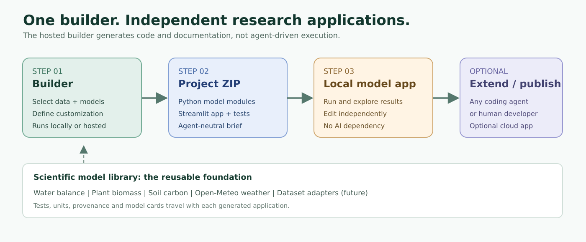
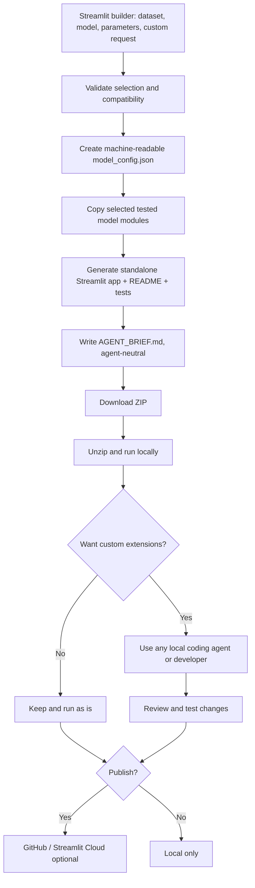
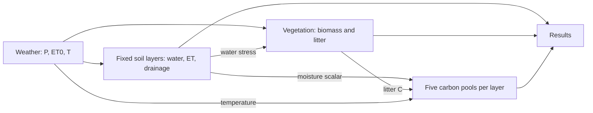

# Architecture and workflow

## Single purpose of the builder

The builder is a **model application factory**, not a universal hosted multi-user simulation service. A user picks **known components** and downloads a self-contained project ZIP. Both local and hosted builders follow the same exact export path.

## Separation of concerns

| Layer | Responsibilities | Must not do |
|---|---|---|
| `studio_builder/` | Resolve models to standard data/validation/backup blocks, package application, generate project brief | Run agent-generated code, require LLM keys, copy arbitrary local files |
| `template_generated_app/models/` | Model equations and state transitions, units, mass conservation tests | Know about Streamlit UI or external credentials |
| `template_generated_app/weather.py` | Acquire/label forcing data | Silently substitute synthetic data |
| `template_generated_app/data_blocks/` | Independently load source data, preserve units/resolution/provenance, compare complete observation windows | Invent numerical rates from categorical traits or equate incompatible fluxes |
| `template_generated_app/engine.py` | Couple time steps and selected models | Conceal missing dataset adapters |
| Generated `app.py` | Show parameters, run model, chart results | Alter model equations in production without a code change |
| Generated `AGENT_BRIEF.md` | Summarize configuration, customization request, scientific guardrails | Depend on Codex, Claude, Cursor, or any specific agent |

## Scientific component interfaces

One daily step (calabrese-depth-v2):

- Water input/fluxes/storage: mm or mm/day.
- Biomass and soil C stocks: g C/m2.
- Litter and respiration fluxes: g C/m2/day.
- Daily water residual: `change in storage - (P - runoff - ET - drainage)`.
- Daily soil carbon residual: `change in soil carbon - (litter input - heterotrophic respiration)`.
- This checks bookkeeping only, not ecological validity.

## Model-first configuration and runtime context

The builder selects water, plants and soil carbon. The registry resolves their
standard data blocks, comparisons and backups; optional toggles add extra blocks.
Weather is Open-Meteo without a provider selector. Coordinates and dates are
chosen in the exported app. The builder has no run-duration control;
full provider-supported history remains selectable in the exported app.
Daily model contracts determine the current update interval, while observation
blocks keep their monthly, annual or composite support.

`data_blocks.json` describes each selected component and connection. Every block
has an independent callable loader, making it usable without running a model.
Selected source modules, configuration, tests and run provenance work independently
of the builder. Explicit local TRY archive assets are included with their source
terms, attribution and hashes after inspecting those documents; arbitrary files
elsewhere under `data/` are not copied. Review terms before public redistribution.

The app runs the depth engine with explicit preset fallbacks when ancillary
soil data are unavailable. Required weather failures stop a run. Soil properties
map to initial SOC, porosity and estimated texture hydraulics through a versioned
mapping. TRY categories remain distinct from numeric plant-rate assumptions.
Every run exports mappings, initial conditions, source hashes and assumptions.
The first version has no soil-carbon feedback onto hydraulic properties.

## Builder and generated app deployment

- Local prototype: `streamlit run builder_app.py`.
- Hosted builder: deploy **builder repository** to Streamlit Community Cloud; use `st.download_button` for the ZIP.
- Generated projects: user extracts ZIP to their own machine and runs the separate app; may optionally push to their own GitHub repository and deploy to Community Cloud.
- Larger numerical simulations, authentication, access restrictions, storage, and private credentials need separate hosting/security design before any broad public release.

## Interface evolution

V0: dropdowns/check boxes for modules and adapters (working).  
V1: schema-defined model inputs/outputs, compatibility warnings, parameter form per module.  
V2: optional drag-and-connect canvas; canvas edits the same validated config rather than replacing the modeling engine.

## Depth-model and UI implementation (2026-11-09)

Model, Data and Advanced tabs separate setup/run/results from parameters. Native debounced place search offers matches as you type. Runtime dates clamp to available archive boundaries. Run progress uses one loading panel with weather, soil/plant-input and calculation stages, elapsed time, fallback details, compute estimates and opt-in HWSD download byte counts. Source charts/metrics precede expandable records. HWSD exports include only the explicit converted public table and provenance, not arbitrary private data or the large mapping raster. See SCIENCE.md for the parameter mappings and remaining scientific limits.

## Retrieval and calculation performance (2026-11-17)

The Model **Soil data** control selects SoilGrids (250 m, finer detail) or HWSD
(about 1 km, faster) as the first source, with SoilGrids the default. Both mapped
sources are checked in preference order. Batched REST is preferred for SoilGrids,
followed by numeric WMS then WCS; each map route checks 36 values with four workers.
Map retrieval has a
best-effort two-minute budget. The provider's multi-layer HTML repeats the first
layer label, so ambiguous batching is rejected rather than assigning depths by
record order. Finer spatial resolution is not a promise of greater site accuracy.

**Automatically try SoilGrids REST** in Advanced is on by default and provides a
20-second foreground deadline. Service failures open a shared five-minute
cooldown; subsequent uncached lookups retry automatically once it expires.
Missing values open only a one-minute site cooldown. The five-starts-per-minute
budget remains process-wide, and reports identify deliberate cooldown/rate-limit
skips. Disabling the option uses maps only. The provider website's pause notice
does not establish a universal outage; validated live responses are the source
of availability evidence. See [REST status](SOILGRIDS_REST_STATUS.md).
A missing soil profile pauses calculation
and shows both mapped-source failures. Only **Use assumed soil preset** explicitly
authorizes fallback assumptions after both have failed and weather is available.
The default loam and 6,200 g C/m² SOC with a 50 cm e-folding depth are editable
assumptions, not observations. The initial modeled profile is 2 m.

Advanced controls the first large HWSD map download; recovery also offers
**Download HWSD map and retry**. Existing maps are reused read-only, downloads
default off, and the global raster is about 1.9 GB uncompressed. Nearby searches
start only on user request; a usable alternative profile resolves the soil input.

`source_cache.py` stores successful, physically validated soil profiles in memory
and versioned JSON under the project `.ems-cache/soil-profiles-v1/` directory.
Entries expire 30 days after retrieval, including after a server restart or a
later disk hit. Source/site/policy/settings and relevant local file signatures
control reuse; simulation dates and unrelated parameters do not. Atomic writes,
checksums and schema/physical checks make a damaged cache a fresh retrieval,
not an alternate soil source. Nearby validation and selected-proxy loading use
the same cache. HWSD table decoding and hashing are reused by file metadata.

Required weather loads before soil; independent traits may overlap soil. Model
results do not wait for optional observation downloads. **Load comparisons**
requests those afterward, retaining existing complete-window, QA and fallback
rules. Run reports include source durations, route diagnostics, cache storage
and calculation time. Model calculation prepares immutable soil arrays once per
run, retaining the water equations, 24 daily substeps and conservation checks.
Performance measurements use offline fixtures and do not establish provider
latency or scientific calibration.
